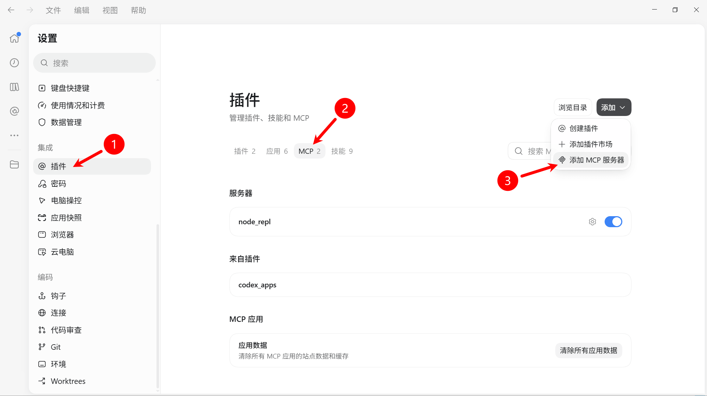
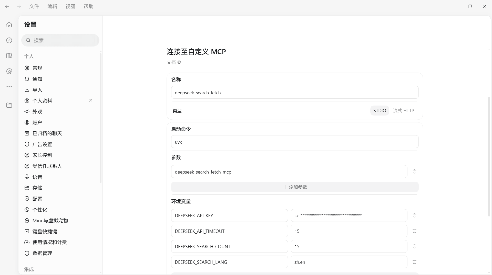
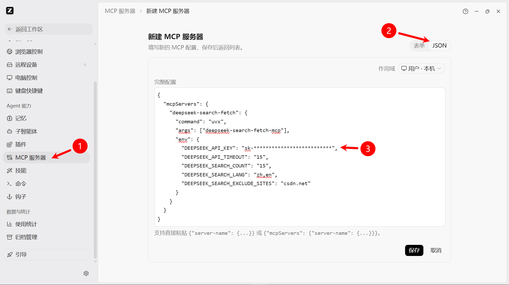

# DeepSeek Search Fetch MCP

[English](https://github.com/festoney8/DeepSeek-Search-Fetch-MCP/blob/main/README.md) | **简体中文**

将 DeepSeek Search API 和 DeepSeek Fetch API 封装为两个 MCP Tool。AI agent 可以检索最新网络信息，按站点、语言和日期筛选结果，再以 Markdown 格式获取指定网站的内容，无需离开 MCP 工作流。

[](https://www.python.org/)
[](https://pypi.org/project/deepseek-search-fetch-mcp/)
[](LICENSE)

## 功能特性

- **基于 stdio 的 MCP 服务**：可直接通过 `uvx` 运行，并接入任意兼容 MCP 的客户端
- **安全校验**：请求上游 API 前先校验工具参数
- **`ds_web_search`**：通过 DeepSeek Search API 检索最新网络信息
- **`ds_web_fetch`**：通过 DeepSeek Fetch API 获取公开 HTTP/HTTPS 页面

## 如何使用

> [!IMPORTANT]
> API Key 仅应保存在 MCP 客户端的环境配置中，请勿提交包含真实密钥的配置文件。

> [!NOTE]
> DeepSeek Search 和 Fetch 服务每 1,000 次成功请求计费 5 元。参考 [文档](https://api-docs.deepseek.com/zh-cn/quick_start/pricing/#%E7%BD%91%E9%A1%B5%E6%90%9C%E7%B4%A2%E4%B8%8E%E6%8A%93%E5%8F%96%E4%BB%B7%E6%A0%BC)

### 环境要求

- 需安装 [uv](https://docs.astral.sh/uv/getting-started/installation/)
- Python 3.11 或更高版本
- DeepSeek API Key

### 最小配置

此模板仅传入 API Key，请求超时和全部 Search 相关环境变量使用默认值。

```json
{
  "mcpServers": {
    "deepseek-search-fetch": {
      "command": "uvx",
      "args": ["deepseek-search-fetch-mcp"],
      "env": {
        "DEEPSEEK_API_KEY": "sk-**********"
      }
    }
  }
}
```

### 完整配置

此模板包含全部支持的环境变量，可按实际搜索策略删除或修改可选值。各环境变量说明参考**环境变量**章节。

```json
{
  "mcpServers": {
    "deepseek-search-fetch": {
      "command": "uvx",
      "args": ["deepseek-search-fetch-mcp"],
      "env": {
        "DEEPSEEK_API_KEY": "sk-**********",
        "DEEPSEEK_API_TIMEOUT": "30",
        "DEEPSEEK_SEARCH_COUNT": "20",
        "DEEPSEEK_SEARCH_LOCALIZATION": "18.8.8.8",
        "DEEPSEEK_SEARCH_NEED_CONTENT": "false",
        "DEEPSEEK_SEARCH_LANG": "zh,en",
        "DEEPSEEK_SEARCH_EXCLUDE_WORDS": "word1|word2",
        "DEEPSEEK_SEARCH_EXCLUDE_SITES": "csdn.net|baidu.com"
      }
    }
  }
}
```

### DeepSeek Harness (DSH)

无需使用本 mcp，DSH 已经内置了 [@deepseek-ai/dsh-web-search-deepseek](https://github.com/deepseek-ai/deepseek-harness/tree/master/packages/web/web-search-deepseek) 插件。

如果你使用第三方模型，需在 `$DSH_HOME/.credentials.yaml` 文件的 `refs` 字段内新增

```
DEEPSEEK_API_KEY=sk-********************
```

并重启 DSH，即可让第三方模型也能用 dsh-web-search-deepseek

### ChatGPT Desktop (Codex)




### Zcode



### 常见问题

#### 在 WSL 或 SSH 环境中已安装 uv，但非登录 shell 找不到 uvx 怎么办？

使用 Zsh，并在 `~/.zshenv` 中加入以下配置，使非登录和非交互 shell 也能找到 `~/.local/bin` 。这一方法也能解决已安装但找不到 fnm、npm、pnpm 等工具的问题

```zsh
typeset -U path
path=(
  "$HOME/.local/bin"
  $path
)
export PATH
```

## 环境变量

| 环境变量                        | 必填 | 默认值 | 说明                                                                                                                                                  |
| ------------------------------- | ---- | ------ | ----------------------------------------------------------------------------------------------------------------------------------------------------- |
| `DEEPSEEK_API_KEY`              | 是   | -      | DeepSeek API Key，必须匹配 `^sk-[a-zA-Z0-9]+$`                                                                                                        |
| `DEEPSEEK_API_TIMEOUT`          | 否   | `30`   | 请求超时秒数，必须大于 0，不会自动重试                                                                                                                |
| `DEEPSEEK_SEARCH_COUNT`         | 否   | `10`   | `ds_web_search` 默认结果数量，范围 1 到 50。工具参数优先                                                                                              |
| `DEEPSEEK_SEARCH_LOCALIZATION`  | 否   | -      | 传递给 Search API 的公网单播 IPv4 地址，用于结果本地化。通常不需要设置                                                                                |
| `DEEPSEEK_SEARCH_NEED_CONTENT`  | 否   | -      | Search API 是否在搜索结果中包含页面内容。支持 `true`、`1`、`false`、`0`，不区分大小写。不推荐开启，会占用大量上下文                                   |
| `DEEPSEEK_SEARCH_LANG`          | 否   | -      | 默认语言限制，使用逗号分隔的 ISO 639-1 语言码，例如 `zh,en`。`lang` 工具参数优先                                                                      |
| `DEEPSEEK_SEARCH_EXCLUDE_WORDS` | 否   | -      | 全局排除词，使用 `\|` 分隔。每个词会作为排除短语加入搜索，且不得包含双引号或控制字符。不常用，建议不超过 3 个；排除词会占用 query 的 128 字符长度限制 |
| `DEEPSEEK_SEARCH_EXCLUDE_SITES` | 否   | -      | 全局排除站点，使用 `\|` 分隔。每项必须是合法裸域名，并会作为排除站点加入搜索。建议不超过 3 个；排除站点会占用 query 的 128 字符长度限制               |

可选环境变量为空时会被忽略。非空值会在服务启动时校验，配置非法时服务直接退出，不接收请求。

## 工具

| 工具            | 作用                                     |
| --------------- | ---------------------------------------- |
| `ds_web_search` | 按站点、语言、日期和结果数量检索相关页面 |
| `ds_web_fetch`  | 读取指定公开 URL 的智能体友好内容        |

### `ds_web_search`

| 参数           | 必填 | 类型     | 说明                                                                                                 |
| -------------- | ---- | -------- | ---------------------------------------------------------------------------------------------------- |
| `query`        | 是   | string   | 搜索词，最多 100 个字符。用双引号包裹短语可进行精确匹配                                              |
| `ori_question` | 否   | string   | 触发搜索的用户原始问题，最多 128 个字符，用于帮助理解搜索意图                                        |
| `count`        | 否   | integer  | 结果数量，范围 1 到 50。指定时覆盖 `DEEPSEEK_SEARCH_COUNT`，两者都未设置时使用 API 默认值 10         |
| `sites`        | 否   | string[] | 仅搜索指定裸域名，例如 `github.com`。禁止包含协议、路径或通配符                                      |
| `lang`         | 否   | string[] | 使用 ISO 639-1 语言码限制结果，例如 `["zh", "en"]`。传入空列表时，本次搜索不使用环境变量中的语言限制 |
| `after`        | 否   | date     | 仅返回此 `YYYY-MM-DD` 日期之后的结果                                                                 |
| `before`       | 否   | date     | 仅返回此 `YYYY-MM-DD` 日期之前的结果。`after` 不得晚于 `before`                                      |

服务端会将 `sites`、`lang`、`after`、`before` 以及配置的排除项转换为 DeepSeek 搜索语法。包含生成过滤条件的最终 query 最长不得超过 128 个字符。

### `ds_web_fetch`

| 参数  | 必填 | 类型   | 说明                                     |
| ----- | ---- | ------ | ---------------------------------------- |
| `url` | 是   | string | 公开 HTTP 或 HTTPS URL，最多 8192 个字符 |

URL 必须包含主机名，不得包含用户名、密码或空白字符，并且不得指向 `localhost`、内网地址或其他非公网 IP 地址。

## 使用示例

让 MCP 客户端搜索最新信息：

```text
搜索 GitHub 和 Hugging Face 上近期的 MCP Server 示例，然后获取最相关页面的内容。
```

客户端可以这样调用 `ds_web_search`：

```json
{
  "query": "MCP server Python",
  "sites": ["github.com", "huggingface.co"],
  "lang": ["en"],
  "count": 15,
  "after": "2026-01-01"
}
```

随后对选中的结果调用 `ds_web_fetch`：

```json
{
  "url": "https://github.com/modelcontextprotocol/python-sdk"
}
```

`ds_web_search` 返回 `results` 数组，包含 `title`、`url`、`summary`、`content`、`site_name`、`date`、`authority`、`rerank_score` 等字段。`ds_web_fetch` 返回页面 `title` 和 `content`。

## 行为与校验

- 所有工具参数都会在请求 DeepSeek API 前完成校验
- `count` 和 `lang` 工具参数会覆盖服务端环境变量默认值
- 传入 `lang: []` 时，本次搜索不使用配置的语言限制
- 站点、语言、日期和排除条件会转换为 DeepSeek 搜索语法
- `ds_web_fetch` 仅接受公开 HTTP/HTTPS URL
- 上游 API 返回错误时，MCP 工具错误会包含可用的状态码、错误码和错误类型

> [!TIP]
> 先使用 `ds_web_search` 查找来源，再只对需要详细阅读的页面调用 `ds_web_fetch`。这样可以减少客户端上下文占用，避免抓取无关页面。

## 开发

克隆仓库并安装项目环境：

```bash
git clone https://github.com/festoney8/DeepSeek-Search-Fetch-MCP.git
cd DeepSeek-Search-Fetch-MCP
uv sync
```

运行本地服务：

```bash
DEEPSEEK_API_KEY="sk-**********" uv run deepseek-search-fetch-mcp
```

运行项目检查：

```bash
uvx ruff format .
uvx ruff check --fix .
uvx ty check --fix .
```

### 项目结构

```text
src/deepseek_search_fetch_mcp/
├── main.py        # FastMCP 服务与工具
├── env.py         # 环境变量加载与校验
├── request.py     # 请求校验与搜索语法构建
├── utils.py       # 域名和语言规范化
└── api/
    ├── api.py     # DeepSeek HTTP 客户端
    └── models.py  # 请求与响应模型
scripts/           # 测试脚本
```

### 技术栈

- [FastMCP](https://gofastmcp.com/)：实现 MCP 服务和工具 Schema
- [aiohttp](https://docs.aiohttp.org/)：异步请求 DeepSeek API
- [Pydantic](https://docs.pydantic.dev/)：类型化配置与数据校验
- [validators](https://github.com/python-validators/validators)：校验 URL 和域名
- [iso639-lang](https://pypi.org/project/iso639-lang/)：校验 ISO 639-1 语言码

### 文档

- [设计文档](docs/design/)
- [测试方法](/scripts/README.md)
- [DeepSeek 网页搜索与抓取](https://api-docs.deepseek.com/guides/search)
- [DeepSeek Search API](https://api-docs.deepseek.com/api/search/)
- [DeepSeek Fetch API](https://api-docs.deepseek.com/api/fetch/)
